# dcp 运行流程：改前 / 改后（v2）

约束基线：**保留 `[dcp:context]` 令牌阈值推送（含每 10% 括号）；删除其余机械闸门**（`[dcp:unit]` 单元推送、`unitRemindId` 水位、摘要形状检查）；决策知识全部搬进工具描述。

状态：**已实现（2026-11-04）**。改前图为改动前的代码，改后图为当前代码。

实现记录：

| 项 | 落地 |
|---|---|
| P1(a) 提醒只给事实 | `remind.ts` 的 `[dcp:context]` 文本改为「估算 tokens + 占比 + live 锚点 + 指向 compress 描述」 |
| P2 不新增查询工具 | 无新增注册 |
| P3 保持 compaction 关闭 | 未改 `config.yml` |
| P4 吸收取 min(lo) | `transform.ts:resolveBlocks` 用 `ancestorsOf` 把起点扩到最早已吸收跨度；复活风险由 smoke §20 覆盖 |
| F1 锚点名解析 | `anchors.ts:readAnchorArg/anchorNameOf`：`anchor`→`name`→`anchorName`→`content`，排除元字段，裸 token，JSON 解析失败时按文本提取 |
| 删 unit 触发 | `remind.ts` 删 `[dcp:unit]`/`finishedTodoSet`/`FinishedUnit`；`state.ts` 删 `unitRemindId`，版本 5→6（兼容读 4/5） |
| 删形状检查 | `src/summary.ts` 整文件删除；gist 改为 `transform.ts` 的首行投影 |

验证：`node node_modules/typescript/bin/tsc --noEmit` 通过；`node --experimental-strip-types --experimental-loader ./work/ts-resolve.mjs smoke-test.ts` → `ALL OK`（含新增 §16 锚点名解析、§20 吸收跨度；把 §20 断言的修复临时关掉时该用例失败，证明可证伪）。

## 修正记录（v2 相对 v1）

1. **图错**：v1 把"令牌 level 未推进"画成直接"不注入"。源码 `remind.ts:252-272` 的早退只在**发出**令牌提醒时发生；未推进（含低于阈值）会继续走 unit 检查。本图已修正。
2. **编号分域**：v1 节点 `D1…D8` 与决策 `D1…D4` 撞号。v2 节点按路径分域（`bR*` 改前请求、`bC*` 改前压缩、`bT*` 改前工具；`a*` 同构），决策统一 `P1…P4`。
3. **撤回一条错误推荐**：v1 曾推荐"打开 omp compaction 作硬兜底"。源码证据相反——`hooks.ts:87-96`（`reconcileOmpCompaction`）与 `hooks.ts:189-191`（`session_compact`）在 compaction 落地时 `clearCompressionState` 并落盘，即**开启 omp compaction 会清空整条块链**。该选项改记为"不可行，除非先做协同"。
4. **推断标注**："0 次 `add_anchor` / 0 次 `expand`" 降级为 `[INFERENCE]`：transcript 的 `toolCall` 不落盘 `arguments`，无法直接观测；依据是 `dcp-state` 三个块 `startName` 全为 `session_start`（没有被使用的活锚点）。
5. **新增未验证风险 V1**（见文末）。

## 已决（不再列入待定）

| 项 | 结论 |
|---|---|
| `[dcp:context]` + 每 10% 括号 | 保留 |
| `[dcp:unit]` todo 完成推送、`unitRemindId` | 删除 |
| 摘要形状检查与结果内提示 | 删除 |
| 约束归属 | 全部进工具描述 |

---

## 图一 · 改前（当前代码，v5）

```mermaid
flowchart TD
  subgraph REQB["A. 每请求 · context 事件（唯一注入点）"]
    bR1["深拷贝消息；会话存储永不修改"] --> bR2{"已绑定 sessionId？"}
    bR2 -- 否 --> bR3["bindSession：reset + 从分支载入块链"]
    bR2 -- 是 --> bR4
    bR3 --> bR4["reconcileOmpCompaction：更新的 compaction → 清空块 + 标 dirty"]
    bR4 --> bR5["applyCompressions<br/>resolveBlocks → elide → 剥离起始锚点<br/>→ 注入摘要与祖先索引 → 孤儿与空壳守卫"]
    bR5 --> bR6["maybeAppendReminder（每请求最多一条）"]
    bR6 --> bR7{"估算 tokens ≥ budget？"}
    bR7 -- 是 --> bR8{"level = floor(tokens/base×10) &gt; 已报 level？"}
    bR8 -- 是 --> bR9["注入 [dcp:context]<br/>Compress NOW · 锚点列表 · 链根/顺序 hint"]
    bR8 -- 否 --> bR11["查最新 todo 结果：全部完成且 id ≠ unitRemindId？"]
    bR7 -- 否 --> bR10["remindLevel 归零"] --> bR11
    bR11 -- 是 --> bR12["注入 [dcp:unit]<br/>已完成单元 = 边界 · Compress NOW"]
    bR11 -- 否 --> bR13["不注入"]
    bR9 --> bR14["发往 provider（提醒从不落盘）"]
    bR12 --> bR14
    bR13 --> bR14
  end

  subgraph COMPB["B. compress 工具 execute"]
    bC1["startAnchor / summary 非空字符串"] --> bC2["parseSummary<br/>形状问题仅作建议"]
    bC2 --> bC3["branchMessages → scanAnchors<br/>含虚拟 session_start 与 xd 封装；无活性过滤"]
    bC3 --> bC4{"startAnchor 存在？"}
    bC4 -- 否 --> bC5["抛错：列出可用锚点；状态不变"]
    bC4 -- 是 --> bC6["endIdx = 本次调用位置<br/>elideFrom = 锚点后一条"]
    bC6 --> bC7{"elideFrom &lt; endIdx？"}
    bC7 -- 否 --> bC8["抛错：空 span；状态不变"]
    bC7 -- 是 --> bC9["absorbed = compress 调用落在 span 内的 live 块<br/>swallowed = span 内的锚点名"]
    bC9 --> bC10["记块 · absorbed.supersededBy · usageMark · 落盘"]
    bC10 --> bC11["结果文本：elided 数 · 吸收链索引(gist 60)<br/>· 被吞锚点名 · 形状提示（未拒绝）"]
  end

  subgraph TOOLB["C. 其他工具与生命周期"]
    bT1["add_anchor：名校验 · 重名拒绝"]
    bT2["expand：摘要全文 + 更深层索引"]
    bT3["session_start / switch → bind + 载入"]
    bT4["before_switch / shutdown → dirty 才 flush"]
    bT5["session_compact → 清空块并落盘"]
  end
```

---

## 图二 · 改后（目标，v6）

```mermaid
flowchart TD
  subgraph REQA["A. 每请求 · context 事件"]
    aR1["深拷贝消息；会话存储永不修改"] --> aR2{"已绑定 sessionId？"}
    aR2 -- 否 --> aR3["bindSession：reset + 载入块链（v6：无 unitRemindId）"]
    aR2 -- 是 --> aR4
    aR3 --> aR4["reconcileOmpCompaction：更新的 compaction → 清空块 + 标 dirty"]
    aR4 --> aR5["applyCompressions（与改前一致）"]
    aR5 --> aR6["maybeAppendReminder：只剩令牌阈值一条通路"]
    aR6 --> aR7{"估算 tokens ≥ budget？"}
    aR7 -- 是 --> aR8{"level = floor(tokens/base×10) &gt; 已报 level？"}
    aR8 -- 是 --> aR9["注入 [dcp:context]<br/>上下文事实 + 指向 compress 描述的决策规则"]
    aR8 -- 否 --> aR11["不注入（不再有第二条通路）"]
    aR7 -- 否 --> aR10["remindLevel 归零"] --> aR11
    aR9 --> aR12["发往 provider（提醒从不落盘）"]
    aR11 --> aR12
  end

  subgraph COMPA["B. compress 工具 execute"]
    aC1["startAnchor / summary 非空字符串"] --> aC2["branchMessages → scanAnchors<br/>（不再解析摘要形状）"]
    aC2 --> aC3{"startAnchor 存在？"}
    aC3 -- 否 --> aC4["抛错：列出可用锚点；状态不变"]
    aC3 -- 是 --> aC5["endIdx = 本次调用位置<br/>elideFrom = 锚点后一条"]
    aC5 --> aC6{"elideFrom &lt; endIdx？"}
    aC6 -- 否 --> aC7["抛错：空 span；状态不变"]
    aC6 -- 是 --> aC8["absorbed / swallowed 计算<br/>P4 若采纳：新块 lo = min(自身 lo, 被吸收块 lo)"]
    aC8 --> aC9["记块 · supersededBy · usageMark · 落盘"]
    aC9 --> aC10["结果文本：elided 数 · 吸收链索引（摘要首行）<br/>· 被吞锚点名 · 「下一个锚点放在本次调用之后」<br/>（形状提示已删除）"]
  end

  subgraph TOOLA["C. 其他工具与生命周期"]
    aT1["add_anchor：名校验 · 重名拒绝<br/>时机与顺序由提示词说明"]
    aT2["expand：摘要全文 + 更深层索引（gist = 摘要首行）"]
    aT3["session_start / switch → bind + 载入"]
    aT4["before_switch / shutdown → dirty 才 flush"]
    aT5["session_compact → 清空块并落盘"]
  end
```

---

## 合成消息：改前 / 改后

| 进入 LLM 上下文的合成消息 | 改前 | 改后 |
|---|---|---|
| 压缩摘要 + 祖先索引 | 每请求注入 | 每请求注入（gist 改摘要首行） |
| `[anchor: session_start …]` | 每请求注入 | 每请求注入 |
| `[dcp:context]` | 有 | **保留**（文本收缩为事实 + 指针，P1） |
| `[dcp:unit]` | 有 | **删除** |
| 摘要形状提示 | 有 | **删除** |

## 节点级差异（增量）

| 环节 | 改前 | 改后 |
|---|---|---|
| 提醒通路 | 令牌未推进 → 继续走 unit | 令牌未推进 → 不注入 |
| 状态字段 | `usageMark` + `remindLevel` + `unitRemindId` | 前两者保留，`unitRemindId` 删除 |
| 摘要入参 | `parseSummary` 产形状问题 | 无解析 |
| 结果文本 | 尾部附形状提示 | 换成「下一个锚点放在本次调用之后」 |
| 索引 gist | 解析槽位取「当前任务」 | 摘要首行截断 |
| 源文件 | `remind.ts` + `summary.ts` | 删 unit 分支与 `summary.ts` 整文件 |

## 决策（已定，2026-11-04）

| # | 决策 | 结论 |
|---|---|---|
| P1 | 提醒文本形态 | **(a)** 事实 + 指向 `COMPRESS_PROMPT` 的决策规则；不再复述指令与两个 hint |
| P2 | 拉取式只读查询 | **不新增**：阈值推送已提供压力信号 |
| P3 | 窗口硬兜底 | **保持关闭**（`compaction.enabled=false`）。依据：`hooks.ts:87-96`、`189-191` 在 compaction 落地时清空块链 |
| P4 | 吸收包含性 | **本次修**：吸收时新块 elide 起点取 `min(自身 lo, 被吸收块 lo)`，堵掉复活空洞 |

旧编号映射：v1 设计版 `D1`（预算）已由"保留阈值推送"终结；`D2`（兜底）→ `P3`；`D3`（范围）→ `P4`；v1 修订版 `D1`→`P1`、`D2`→`P2`。

## 验证结果（V1 已验，2026-11-04）

方法：真实会话文件 + 扩展自己的 `scanAnchors`（`node --experimental-strip-types`，loader `work/ts-resolve.mjs`），对 236 个**顶层**会话（含 ≥1 次真实 `xd://add_anchor`）逐条重放 `tools.ts` + `transform.ts` 的状态机。

| 项 | 结果 |
|---|---|
| V1 原假设（`toolCall` 不落盘 `arguments` → 锚点重启后不可解析） | **证伪**：被测会话 1079/1079 个 toolCall 都带 `arguments`；284 个会话存在 1015 次真实 `xd://add_anchor`；894 个命名锚点可被 `scanAnchors` 解析。原判断源于我用错键（`args`/`input` 而非 `arguments`） |
| 锚点载荷可解析性 | 995 条可解析 + 20 条 `JSON.parse` 失败（2.0%，字符串内含未转义控制字符） |
| `readAnchorArg` 回退 | 699 条靠"唯一字符串值"恢复；**39 条（3.9%）判 null → 锚点不可见**（模型同时写了 `i`/`note`/`summary` 等第二个字符串字段） |
| 锚点不可见合计 | ≈ 5.9%（59 / 1015） |
| compress 找不到 startAnchor | 1251 次中 41 次（3.3%）；抽样 25 例中 7 例（28%）正是上述不可见锚点，18 例是模型用了从未创建的名字 |
| P4 复活实测 | 236 个顶层会话中 **29 个**出现复活，累计 **69,699 条**消息，单次最大 **3,051 条** |

P4 机制（与实测一致）：`tools.ts` 吸收只判"旧块 compress 调用落在新 span 内"；`transform.ts:59` 对 superseded 块不再 elide；新块只从自己的 lo 起 elide → `[oldLo, newLo)` 成为空洞。

## 新增缺陷 F1（待决）

`anchors.ts:readAnchorArg` 的"唯一字符串值"回退在模型写第二个字符串字段时失效，锚点静默不可见（实测 3.9%）。修法：优先读 `anchor` / `name` 键，排除 `i` / `title` / `note` / `summary` 等元字段；两者都没有才回退到唯一字符串，且永不取 `i` 的值。
